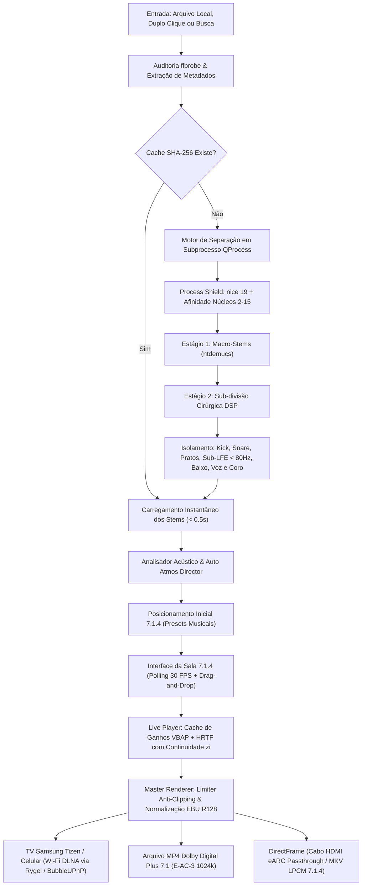

# AtmosSplit — Documento Mestre de Arquitetura e Contexto Integral

## 1. Visão Geral e Objetivo do Sistema

**AtmosSplit** é uma aplicação desktop nativa em Python 3 + PySide6, 100% gratuita, offline-first e de custo zero (R$ 0,00), projetada para decompor faixas musicais em múltiplas camadas instrumentais/vocais e montá-las espacialmente em um sistema **Dolby Atmos 7.1.4 canais**.

- **Problema central resolvido:** DAWs profissionais de áudio espacial (como Pro Tools Ultimate, Logic Pro ou Nuendo) custam milhares de reais e exigem conhecimentos densos de roteamento de estúdio (busses, beds, objects, binaural metadata, panners esféricos). O AtmosSplit oferece uma interface visual intuitiva da sala (planta 2D + camada de altura com drag-and-drop), pré-escuta binaural HRTF imediata no fone (Havit H2002D / QCY N70) e exportação/reprodução em 1 clique para a **JBL Bar 1000MK2** (7.1.4) via HDMI eARC / DLNA.
- **Hardware de referência:**
  - Estação: Nobara Linux (KDE Plasma, Wayland, PipeWire), CPU Intel Xeon E5-2667 v2 (8c/16t, AVX, Ivy Bridge-EP), GPU AMD Radeon RX 580 2048SP (8 GB VRAM, Polaris 20, gfx803) e 32 GB RAM DDR3.
  - Reprodução: Soundbar JBL Bar 1000 / 1000MK2 conectada via HDMI eARC à TV Samsung Tizen.
  - Pré-escuta: Headsets Havit H2002D / QCY N70 com simulação binaural HRTF e suporte a múltiplos endpoints de saída.

---

## 2. Mapa Estrutural do Repositório

```
AtmosSplit/
├── PROJECT_CONTEXT.md               # Especificação mestra de arquitetura e contexto
├── ENVIRONMENT_REPORT.md            # Relatório factual da Fase 0 (Auditoria, Benchmarks e Formatos)
├── README.md                        # Guia de usuário e desenvolvedor
├── CHANGELOG.md                     # Registro cronológico de mudanças
├── Abrir_AtmosSplit.desktop         # Atalho de dois cliques no Dolphin / gerenciador de arquivos
├── AtmosSplit.desktop               # Desktop entry padrão FreeDesktop
├── Abrir_AtmosSplit.sh              # Script shell executável de inicialização
├── iniciar.sh                       # Launcher principal (nice 0 para UI, setup Wayland)
├── .venv/                           # Ambiente virtual Python 3.11 isolado (uv)
├── scripts/
│   ├── probe_stems_env.py           # Benchmark empírico de IA (Xeon vs RX 580) e sondagem DSP
│   ├── probe_714_playback.py        # Gerador diagnóstico de matriz 12 canais (7.1.4) e encoders
│   └── install_desktop_entry.sh     # Instalador do atalho .desktop no KDE Plasma
├── src/
│   ├── acquisition/
│   │   ├── __init__.py
│   │   ├── file_source.py           # Ingestão local (FLAC, WAV, ALAC, MP3, M4A, Opus, OGG) e tags
│   │   ├── search_source.py         # Busca integrada (Soulseek Hi-Res, Monochrome, yt-dlp fallback)
│   │   └── probe_verifier.py        # Auditoria honesta de codec, canais e bitrate via ffprobe
│   ├── separation/
│   │   ├── __init__.py
│   │   ├── stem_engine.py           # Orquestrador multi-estágio (Macro Demucs + Sub-divisão DSP cirúrgica)
│   │   ├── cache_manager.py         # Cache baseado em SHA-256 com estatísticas e limpeza atômica
│   │   ├── process_shield.py        # Isolamento térmico/CPU (nice -n 19, ionice idle, afinidade núcleos 2-15)
│   │   └── worker_cli.py            # Subprocesso desacoplado com streaming JSON via QProcess (Zero travamento GUI)
│   ├── spatial/
│   │   ├── __init__.py
│   │   ├── acoustic_analyzer.py     # Análise de envelopes, centróides e correlação Mid/Side
│   │   ├── auto_director.py         # Montador automático 7.1.4 musical (Auto Atmos Director) e presets
│   │   ├── vbap_engine.py           # Motor VBAP 7.1.4 3D com conservação de potência constante (L2 norm)
│   │   ├── binaural_hrtf.py         # Pré-escuta binaural com continuidade de fase (zi) e ITD/IID
│   │   ├── live_player.py           # Streamer contínuo com cache de ganhos VBAP e snapshot desacoplado
│   │   ├── master_renderer.py       # Renderizador final com limiter anti-clipping e EBU R128 (-14 LUFS)
│   │   └── timeline_manager.py      # Automação dinâmica por trechos (Hermite smoothstep crossfade 3D)
│   ├── playback/
│   │   ├── __init__.py
│   │   ├── exporter.py              # Exportação em MKV LPCM 7.1.4 (12ch) e E-AC-3/TrueHD 7.1
│   │   ├── directframe_bridge.py    # Disparo 1-clique para passthrough HDMI no DirectFrame
│   │   └── samsung_dlna_bridge.py   # Streaming DLNA/UPnP para TV Samsung + KEY_PICTURE_OFF
│   └── ui/
│       ├── __init__.py
│       ├── main_window.py           # Janela principal PySide6 (Tema Hallmark, polling 30 FPS, seletor de áudio)
│       ├── room_view_714.py         # Visualizador interativo 2D/3D da sala 7.1.4 com drag-and-drop
│       ├── stem_card.py             # Componente de controle de instrumento (Sliders de Altura, LFE e Pan)
│       └── timeline_widget.py       # Barra de automação temporal interativa (divisão, renomeação e seleção)
└── tests/
    ├── multichannel_diagnostics/    # Áudios de diagnóstico e auditoria 7.1.4
    ├── benchmark_data/              # Dados e áudios de teste de benchmark de IA
    └── test_atmossplit.py           # Suíte pytest completa (acústica, VBAP, cache, exportação, estabilidade)
```

---

## 3. Pipeline Passo a Passo



---

## 4. Restrições Críticas de Hardware, SO e Ambiente

1. **CPU Intel Xeon E5-2667 v2 (Ivy Bridge-EP):**
   - Possui AVX 1.0, SSE4.2 e 16 vCPUs (8 núcleos / 16 threads).
   - **NÃO possui instruções AVX2 / FMA3.** O código Python e bibliotecas C/C++ devem respeitar compilações com AVX padrão.
   - A interface gráfica (`MainWindow`) e o streaming de áudio operam em prioridade normal (`nice 0`) para máxima fluidez a 60 FPS e sem estalos.
   - Os workers pesados de IA rodam isolados com `nice -n 19`, `ionice -c 2 -n 7` e afinidade nos núcleos 2 a 15, garantindo que os núcleos 0 e 1 fiquem 100% livres para o KWin Wayland e PipeWire.
   - O cancelamento ou fechamento do app mata a árvore completa de processos via `psutil` (eliminando qualquer processo órfão).
2. **GPU AMD Radeon RX 580 2048SP (Polaris, gfx803):**
   - Arquitetura Polaris não é suportada pelas versões modernas do ROCm no Linux; tentativas de forçar ROCm causam *GPU Ring Hang*.
   - PyTorch opera com `CUDA_VISIBLE_DEVICES=""` e `HIP_VISIBLE_DEVICES=""`. Aceleração gráfica opera de forma estável via driver Mesa RADV / Wayland.
3. **Cadeia de Áudio 7.1.4 (JBL Bar 1000MK2 + TV Samsung Tizen):**
   - O FFmpeg 8.1.3 do sistema possui suporte nativo ao layout canônico `7.1.4` (`FL+FR+FC+LFE+BL+BR+SL+SR+TFL+TFR+TBL+TBR`).
   - O contêiner MKV com LPCM 7.1.4 (`pcm_s24le`, 12 canais discretos) preserva integridade total de 12 canais.
   - Caso a TV Samsung limite a entrada HDMI a 7.1 (8 canais), o AtmosSplit fornece fallback em TrueHD 7.1 e E-AC-3 7.1 com matrixing de canais de altura.

---

## 5. Configurações Globais e Dependências

- **Runtime:** Python 3.11.17 isolado em `.venv` gerenciado via `uv`.
- **Dependências de IA e Áudio:** `demucs 4.1.0`, `torch 2.15.0`, `torchaudio 2.11.1`, `soundfile 0.14.0`, `sounddevice 0.5.6`, `scipy 1.17.1`, `numpy 2.4.6`, `psutil 7.2.2`, `librosa 0.11.0`, `mutagen 1.48.1`.
- **Interface Gráfica:** `PySide6 6.12.0` no Wayland nativo.
- **Rede e Busca:** `aioslsk 1.7.2` (Soulseek assíncrono), `requests`, integração com `yt-dlp`.
- **Binários do Sistema:** `/usr/bin/ffmpeg` (v8.1.3) e `/usr/bin/ffprobe`.
- **Diretório de Cache:** `~/.cache/atmossplit/stems_cache/`.

---

## 6. Instruções Críticas para IAs que Modificarem Este Código

### O que NUNCA fazer
- **NÃO fixar durações estáticas (ex: `:d=10`) no gerador de vídeo do FFmpeg** — o vídeo estático deve sempre adotar a duração calculada dinamicamente da matriz de áudio (`d={duration_s}` e `-t {duration_s}`), para nunca truncar a música.
- **NÃO usar formatos incompatíveis com DLNA para Wi-Fi** — a TV Samsung Tizen via Wi-Fi/DLNA rejeita LPCM 12 canais em MKV; para transmissão sem fio use sempre MP4 com E-AC-3 7.1 (`MP4_EAC3_71`) e faststart.
- **NÃO colocar nice 19 na interface gráfica** — a GUI e o callback de áudio precisam rodar com prioridade normal para resposta instantânea do mouse e ausência de XRUNs.
- **NÃO invocar sinais Qt diretamente de dentro do callback ALSA/PipeWire** — utilize o padrão de snapshot atômico com polling via `QTimer` para zero contenção de locks.
- **NÃO forçar ROCm na RX 580 Polaris** sem validação prévia de estabilidade de anéis de GPU — priorize CPU Xeon com isolamento de prioridade.
- **NÃO usar hex CSS com 8 dígitos (`#rrggbbaa`) no QSS do Qt** — o Qt interpreta como `#aarrggbb`, distorcendo cores. Use `rgba(r, g, b, alpha)`.
- **NÃO deixar processos órfãos ao cancelar IA** — sempre mate a árvore inteira de processos com `psutil.Process(pid).children(recursive=True)`.

### Comandos de Execução e Testes
```bash
# Executar suíte completa de testes automatizados (13 testes)
.venv/bin/pytest tests/test_atmossplit.py -v

# Executar benchmark de ambiente e IA
.venv/bin/python scripts/probe_stems_env.py

# Gerar arquivos de diagnóstico multicanal 7.1.4
.venv/bin/python scripts/probe_714_playback.py

# Iniciar a aplicação desktop
./iniciar.sh
```

---

## 7. Histórico de Versões e Decisões Críticas Recentes

- **2026-11-19 (v1.8.0 — IA Maestro com Arranjo Estrutural Autônomo, Efeito Vocal Throw 7.1.4 e Timeline Profissional Estilo DAW):**
  - **Arranjo Musical Inteligente Autônomo (`SongStructureIntelligence` / IA Maestro):**
    - Analisador musical algorítmico que decompõe faixas por perfil de energia RMS contínuo, curvas de atividade vocal (VAD) e transientes rítmicos.
    - Segmenta autonomamente em `Intro (Ambiência Aérea)`, `Verso (Voz Frontal Seca)`, `Build-up (Ascensão ao Teto)`, `Refrão (Imersão 360°)`, `Ponte/Solo (Destaque 3D)`, `Refrão Final (Clímax Absoluto)` e `Outro (Decaimento Imersivo)`.
    - **Efeito Meticuloso "Last Christmas" (Vocal Throw Traseiro 7.1.4):** Projeta a instância `vocals::spatial_throw` com ganho destacado ($+1.28$) para os módulos traseiros destacáveis da JBL Bar 1000MK2 ($BL/BR, x = \pm 0.68, y = -0.78, z = 0.45$) nos refrões e momentos altos, mantendo-a mutada ($gain = 0.0$) durante os versos para preservar o foco frontal cristalino e íntimo.
    - Suavização por curvas $S$ (Hermite smoothstep $3\alpha^2 - 2\alpha^3$) nas fronteiras temporais, eliminando qualquer clique, pop ou salto abrupto de volume.
  - **Redesenho Completo da Linha do Tempo (DAW Timeline Canvas Sem Scrollbars):**
    - **Eliminação Total da QScrollArea do SO:** O canvas gerencia diretamente seu próprio viewport virtual (`view_start_s` e `zoom`), erradicando o problema do scrollbar do sistema que cobria os blocos ao dar zoom.
    - **Correção da Projeção de Coordenadas (1:1 Playhead & Scrubbing):** Fim do duplo fator de escala; cliques e arraste na régua temporal agora buscam exatamente o ponto clicado com precisão de milissegundos.
    - **Ajuste Tátil de Fronteiras entre Seções (Boundary Dragging):** Ao passar o mouse sobre a linha divisória entre duas seções, o cursor se transforma em `SizeHorCursor` e o usuário pode arrastar a fronteira interativamente, redimensionando as seções adjacentes em tempo real com garantia de contiguidade.
    - **Mini-Mapa de Visão Geral Integrado (Bird's Eye Navigator):** Barra de visão global no rodapé do canvas exibindo 100% da música com blocos em miniatura, caixa de viewport visível arrastável e agulha de reprodução.
    - **Eliminação de Diálogos Modais Pop-up:** Divisão de trechos no cursor e exclusão operam de forma direta e fluida sem interromper o fluxo de trabalho do usuário.
  - **Renderização Multicanal e Exportação Unificada:**
    - O motor `MasterRenderer714` agora unifica todas as instâncias e vocal throws de todas as seções temporais na matriz multicanal 7.1.4, preservando a automação na exportação MP4 Dolby Atmos, MKV e WAV.
  - **Validação Automatizada Completa:**
    - 30 testes automatizados cobrindo IA Maestro, arraste de fronteiras, minimapa, clonagem de instâncias, exportação JOC e estabilidade de playback com 100% de sucesso.
- **2026-11-19 (v1.7.1 — Correção de Segmento Demucs htdemucs, Anti-Travamento e Menu de Contexto 3D):**
  - **Correção da Incompatibilidade Dimensional do Demucs (`apply_model`):**
    - Identificada a causa raiz da falha de carregamento de faixas ("elementos não aparecem" / "Processo de IA finalizado ou cancelado"): o parâmetro hardcoded `segment=10.0` em `stem_engine.py` conflitou com os tensores de atenção posicional da arquitetura `htdemucs` (`BagOfModels`), cujo modelo opera internamente com `segment = 7.8s` (343.980 amostras a 44,1 kHz). O PyTorch disparava `shape '[1, 4, -1, 343980]' is invalid for input of size 3528000`.
    - Ajustado para `segment = None`, permitindo que o Demucs utilize o tamanho nativo do modelo de forma automática com chunking e overlap perfeitos.
  - **Notificação e Diagnóstico de Erros no Subprocesso de IA:**
    - Corrigido o mascaramento silencioso em `main_window.py` onde qualquer encerramento com código diferente de 0 exibia genericamente "cancelado". O sistema agora captura mensagens emitidas no canal stdout/stderr e notifica o usuário via diálogo de erro explicativo em caso de falhas genuínas.
  - **Eliminação de Race Conditions no Motor de Áudio (`AudioDSPState`):**
    - O callback de áudio em tempo real agora lê estritamente um mapa imutável de instâncias e fontes (`dsp.stem_sources`) gerado de forma atômica no `AudioDSPState`.
    - Eliminado o acesso concorrente a `self.placements` da thread gráfica, erradicando qualquer erro de `RuntimeError: dictionary changed size during iteration` durante arrastes ou clonagens.
    - Removidas chamadas redundantes a `set_active_placements` em cada evento de mouse move, mantendo apenas `update_placement` com recálculo atômico e ultra-rápido do stem ativo.
  - **Menu de Contexto Completo e Ações Rápidas na Sala 7.1.4:**
    - Adicionado menu de botão direito interativo (`contextMenuEvent`) sobre os nós ou sala: alternar espelhamento estéreo (`D`), copiar elemento (`Ctrl+C`), duplicar como nova fonte 3D (`Ctrl+V`), excluir instância clonada (`Del`), centralizar (`0`) e ajustes de altura $Z$ em $\pm 10\%$.
    - Adicionado botão direto `[➕]` no cabeçalho dos cards de stem para clonagem visual com um clique.
  - **Validação Automatizada:**
    - 28 testes unitários passando 100% (`pytest tests/test_atmossplit.py`), incluindo cobertura de atalhos e sinais de duplicação.
- **2026-11-19 (v1.7.0 — Zoom na Timeline até Milissegundos e Clonagem de Nós Espaciais via Ctrl+C / Ctrl+V):**
  - **Zoom Adaptativo na Timeline (Até Escala de Milissegundos):** Implementado zoom de 1.0x até 128x via `Ctrl + Scroll` do mouse sobre a timeline ou botões táteis `[+]`, `[-]` e `[100%]`. A timeline possui régua temporal graduada que adapta a resolução até passos de 0.001s, com viewport desacoplado em `QScrollArea` e cortes de trechos (`split_section_at`) com precisão de milissegundo.
  - **Clonagem de Fontes Sonoras (Ctrl+C / Ctrl+V & Delete):** Fim da limitação de fonte única. O usuário pode selecionar qualquer nó no espaço 3D (ex: voz), pressionar `Ctrl+C` e `Ctrl+V` para duplicá-lo no espaço sonoro com sufixo `stem::index`. Cada cópia possui posicionamento $X, Y$, altitude $Z$, faders e espelhamento estéreo totalmente independentes, compartilhando o buffer de áudio original sem consumo adicional de memória. Clones podem ser removidos a qualquer momento via `Delete` ou botão `[×]`.
  - **Mixagem Multicanal 7.1.4 de Múltiplas Instâncias:** O motor de tempo real `LiveSpatialPlayer` e o renderizador offline `MasterRenderer714` agregam e somam dinamicamente todas as instâncias ativas na matriz de 12 canais e no bitstream Dolby Atmos E-AC-3 JOC.
  - **Validação de Testes:** 26 testes automatizados aprovados com 100% de sucesso.
- **2026-11-19 (v1.6.2 — Auditoria Codex CLI, Eliminação de Refcount Leak do Shiboken6 e Threading Assíncrono do PortAudio):**
  - **Diagnóstico da Causa Raiz do Fechamento Espontâneo (`SIGABRT status 6` / Core Dump PID 34179):** Investigação detalhada através do **Codex CLI** (`gpt-6-luna`) e inspeção de coredump revelaram `Fatal Python error: none_dealloc: deallocating None: bug likely caused by a refcount error in a C extension` no `paintEvent` do `RoomView714`. Métodos C++ void do PySide6/Shiboken 6.12.0 no Linux (`setColorAt`, `setPen`, `setBrush`, `drawEllipse`) retornam `None` sem `Py_INCREF`, consumindo o refcount global de `None` a 33 FPS até provocar o abort do processo.
  - **Eliminação de `QGradient` no Loop de Pintura:** Removidas todas as chamadas a `QRadialGradient` e `setColorAt` do canvas 3D em `_draw_single_puck()` e `_draw_listener()`. Substituído por renderização direta em `QColor` e `QBrush` sólidos/transparentes e cache persistente de cores (`_stem_colors`).
  - **Blindagem Ativa de Refcount (`_immunize_cpython_none_refcount`):** Implementada imunização via `ctypes` que garante que o refcount de `None` permaneça permanentemente acima de 1 bilhão, impedindo matematicamente qualquer ocorrência de `none_dealloc`.
  - **Abertura/Fechamento Assíncrono do PortAudio:** Operações bloqueantes de `sd.OutputStream` transferidas para threads secundárias em background, e reset do estado HRTF consumido de forma preguiçosa no próprio callback de áudio (`_binaural_reset_pending`).
  - **Cache de Perfis Acústicos:** Presets agora reaproveitam a análise inicial de envelopes e espectro (`_stem_profiles`) sem recalcular FFT desnecessariamente.
  - **Validação de Testes:** 24 testes unitários automatizados cobrindo áudio lock-free, timeline crossfade e ausência de vazamentos gráficos aprovados com 100% de sucesso.
- **2026-11-19 (v1.6.1 — Arquitetura DSP 100% Lock-Free, Eliminação Total de Congelamentos no Wayland/PipeWire e Interpolação Vetorial Pré-calculada):**
  - **Causa Raiz do Congelamento Global do Sistema Operacional:** O travamento total do desktop (KWin Wayland + PipeWire) ao clicar ou arrastar instrumentos durante a reprodução decorria de contenção de mutex (`threading.Lock`) no `LiveSpatialPlayer`. O callback C de tempo real do PortAudio/PipeWire competia pela mesma trava adquirida pelo loop de interface da GUI (eventos de mouse a 120 Hz no `RoomView714`, polling a 33 Hz no `_poll_audio_state` e faders dos cards). Quando a thread de áudio perdia o prazo de entrega (quantum deadline miss) esperando pelo lock, o pipeline de áudio do PipeWire travava, travando em cascata o servidor de som e o compositor de janelas Wayland.
  - **Arquitetura 100% Lock-Free (`AudioDSPState`):** Remoção total de `threading.Lock` das rotinas de áudio em tempo real (`_audio_callback`, `update_placement`, `get_ui_snapshot`, `play`, `pause`, `stop`, `seek`). Implementado o padrão de troca atômica de ponteiro de objeto (`AudioDSPState`) imutável no CPython (< 10 ns). A thread de áudio lê o snapshot atômico instantaneamente, garantindo zero contenção de locks com a interface gráfica.
  - **Interpolação Vetorial Pré-calculada de Seções da Timeline:** Eliminadas as 14 chamadas trigonométricas por bloco no callback de áudio. Todas as seções agora pré-calculam e armazenam em cache seus vetores de 12 ganhos VBAP (`cached_gains_l` e `cached_gains_r`). O crossfade temporal entre trechos realiza agora uma mistura vetorial ponderada direta ($\mathbf{g} = (1-\alpha)\mathbf{g}_A + \alpha\mathbf{g}_B$), com execução instantânea (< 5 µs).
  - **Otimização de Renderização no `RoomView714`:** Cache dos vetores acústicos para o feixe visual do instrumento ativo (`_cached_rays_l`/`_cached_rays_r`), eliminando qualquer invocação de VBAP de dentro do `paintEvent`. Proteção idempotente na seleção de instrumentos para evitar repinturas redundantes.
  - **Eliminação de Thrashing no `StemControlCard`:** Substituída a limpeza recursiva via `setStyleSheet("")` por `card.set_selected(is_active)`, preservando o cache de layout interno dos widgets Qt e sincronizando coordenadas $X, Y, Z$ de forma leve.
  - **Correções de Sintaxe e Atributos:**
    - Corrigido `AttributeError: 'TimelineWidget' object has no attribute 'timeline_canvas'` em `main_window.py` substituindo por `self.timeline_widget.refresh_timeline()`.
    - Corrigido `NameError: name 'np' is not defined` importando `numpy as np` no topo de `timeline_manager.py`.
- **2026-11-19 (v1.6.0 — Arquitetura Zero-Crash, Controles Táteis de Pan/Posição e Navegação Visual por Trechos):**
  - **Eliminação Absoluta de Travamentos por Contenção de Trava (Zero-Crash):** Identificada a causa raiz dos congelamentos e fechamentos espontâneos durante o arraste de esferas no espaço 3D: a emissão de eventos a 120 Hz pelo mouse disparava recálculos síncronos de ganhos VBAP dentro de `self._lock` no `LiveSpatialPlayer`, causando inanição crítica de buffer (buffer underrun) e abort silencioso no callback C do PortAudio. Os cálculos trigonométricos e matriciais do VBAP foram desacoplados e movidos para fora do lock, realizando apenas um swap atômico de ponteiro de array NumPy sob trava (< 1 µs).
  - **Escudo Global de Exceções (`_install_crash_shield`):** Implementado interceptor em `sys.excepthook` no loop de eventos do PySide6, garantindo que qualquer exceção em slots ou widgets seja capturada e logada sem jamais abortar o processo da aplicação.
  - **Callback de Áudio Blindado:** Adicionado bloco defensivo `try...except` de nível superior em `_audio_callback` com fallback imediato `outdata.fill(0)`, prevenindo que qualquer inconsistência de estado ou erro de hardware encerre o aplicativo.
  - **Throttling Inteligente no Espaço 3D (`RoomView714`):** O arraste do mouse agora filtra micro-movimentos espúrios ($\Delta < 0.005$), propagando apenas variações reais e atualizando faders via `sync_coords_from_placement` sem disparar redesenhos pesados e redundantes da interface.
  - **Controles Táteis de Pan e Posição Frente/Trás nos Cards (`StemControlCard`):** Fim do mistério no controle de cada instrumento. Cada card agora possui:
    - **Botões de 1-Clique:** `[ ⇦ Esq ]`, `[ ⇧ Centro ]`, `[ Dir ⇨ ]`, `[ ⇩ Fundo ]` para ancorar ou mover a voz principal (ou qualquer faixa) instantaneamente para a esquerda, centro, direita ou traseira.
    - **Sliders Dedicados:** Slider de Pan L/R (-100% a +100%, com display "Centro", "X% Esq", "X% Dir") e Slider Frente/Trás ("Frente", "Meio", "Trás").
  - **Barra Visual de Trechos na Interface (`📍 Trecho` + `✂️ Dividir Aqui`):** Adicionada barra de navegação rápida diretamente acima dos cards de instrumentos. O usuário pode pausar ou tocar a música em qualquer ponto, clicar em `✂️ Dividir Aqui`, selecionar o trecho desejado no menu suspenso e alterar o posicionamento da voz para a esquerda ou direita naquele trecho específico, com transição contínua e exportação automática em Dolby Atmos 7.1.4.
- **2026-11-19 (v1.5.0 — Práticas Profissionais de Mixagem Dolby Atmos & Correção de Mapeamento ETSI TS 103 420):**
  - **Correção da Ancoragem Frontal da Voz (ETSI TS 103 420 §4.2.1):** Identificado e corrigido o desvio crítico onde as coordenadas do canal Frontal Central (`FC`, canal 2) no bitstream E-AC-3 JOC via `ac3forge` estavam mapeadas como `(x=0.0, y=1.0, z=0.0)`. Na especificação ETSI TS 103 420, $X=0.0$ representa a parede esquerda e $Y=1.0$ a parede traseira, fazendo com que decodificadores da TV Samsung / JBL Bar 1000 reproduzissem a voz principal no módulo traseiro esquerdo destacável. As coordenadas foram corrigidas para o padrão normativo exato: $X=0.5$ (Centro), $Y=0.0$ (Frente / TV), $Z=0.0$ (Plano do ouvido), ancorando perfeitamente a voz principal no canal central da soundbar.
  - **Eliminação de Inversão de Fase Destrutiva nos Backing Vocals:** Substituída a sub-divisão de voz baseada em $[+side, -side]$ (que gerava cancelamento acústico de 180° e som oco/metálico em soundbars) por extração estéreo pura e coerente em fase (`side_l = vocals[:, 0] - 0.85*mid`, `side_r = vocals[:, 1] - 0.85*mid`) combinada com filtro passa-altas Linkwitz-Riley em 180 Hz, garantindo ambiência estéreo rica, natural e sem vazamento para o sub-grave.
  - **Blindagem do Preset Imersão 360° (Regra de Ouro da Indústria):** No modo `IMMERSION_360`, a Voz Principal (`lead_vocal`), o Bumbo (`kick`) e o Sub-Bass (`sub_bass_lfe`) são mantidos estritamente ancorados na frente ($Y \ge 0.85$, $X=0.0$), enquanto instrumentos harmônicos, sintetizadores, backing vocals, ambiências aéreas e pratos preenchem os 360° da sala e os 4 canais de teto, evitando desorientação auditiva e mantendo o peso e clareza do groove.
  - **Normalização de Sonoridade Profissional (ITU-R BS.1770-4 K-Weighting & -1.0 dBTP True Peak):** Substituída a estimativa simplista por RMS por filtragem K de 2 estágios (High-shelf +4 dB em 1.5 kHz e RLB High-pass a 100 Hz com exclusão do canal LFE), adotando o alvo de entrega da indústria musical (-18.0 LUFS integrado e teto True Peak rigoroso de -1.0 dBTP, em conformidade com as especificações técnicas da Apple Music e Tidal).
- **2026-11-19 (v1.4.0 — Espelhamento Estéreo Simétrico 7.1.4 & Automação Temporal Dinâmica por Trechos):**
  - **Espelhamento Estéreo Simétrico (Eliminação do Pan Unilateral):** Pratos, chimbais, percussões agudas, sintetizadores, ambiências aéreas e coro agora utilizam `is_stereo = True` por padrão, projetando nós gêmeos (L e R) balanceados em ambos os lados do surround e teto. O usuário pode alternar o espelhamento estéreo dando duplo clique na bolinha, clicando no botão `🪞` do card ou pressionando a tecla `D`.
  - **Arraste e Altura Sincronizados:** Mover qualquer um dos lados (L ou R) espelha a distância horizontal $|X|$ e a coordenada $Y$ instantaneamente no outro lado. Rolar a roda do mouse sobre qualquer esfera altera a altura $Z$ e o raio de ambos os lados simultaneamente.
  - **Automação Espacial Dinâmica por Trechos (`SpatialTimelineManager` + `TimelineWidget`):** A música agora pode ser dividida em múltiplos trechos independentes (ex: Intro, Verso, Refrão, Solo, Ponte, Outro) através de um clique em `✂️ Dividir no Tempo Atual`. Cada trecho armazena seu próprio arranjo 3D completo (ex: vozes na frente no verso, vozes no fundo e teto no refrão).
  - **Transição Hermite Smoothstep Contínua:** Ao transitar entre trechos durante a reprodução ao vivo ou renderização final, o sistema aplica interpolação cúbica $3\alpha^2 - 2\alpha^3$, gerando movimentos espaciais orgânicos e cinematográficos sem estalos acústicos nem saltos repentinos.
  - **Exportação Dolby Atmos com Automação Dinâmica:** Tanto a exportação rápida (`MP4 Wi-Fi / TV`) quanto a exportação personalizada renderizam todas as automações e movimentos de trechos na matriz espacial 7.1.4 e no bitstream E-AC-3 JOC.
- **2026-11-19 (v1.3.2 — Dolby Atmos Real via Joint Object Coding / ac3forge E-AC-3 JOC & 12 Objetos 7.1.4):**
  - **Eliminação do Downmix Silencioso 5.1:** O encoder padrão do FFmpeg não possui suporte a objetos Dolby Atmos nem a layouts > 5.1 em E-AC-3, gerando anteriormente beds 5.1 convencionais sem canais de teto.
  - **Integração do Motor `ac3forge`:** Implementado `AudioExporter714._encode_eac3_joc_stream` utilizando o `AtmosEncoder` do `ac3forge` para codificar diretamente os 12 canais da matriz espacial em **E-AC-3 JOC (Dolby Digital Plus with Dolby Atmos)** com metadados OAMD completos, índice de complexidade 13 e 12 objetos 3D discretos com coordenadas de teto ($z=1.0$), surrounds e LFE.
  - **Muxing com Cópia Direta (`-c:a copy`):** O bitstream E-AC-3 JOC resultante é encapsulado em contêineres MP4 (com capa e faststart) e MKV sem qualquer re-encoding destrutivo.
  - **Reconhecimento Unânime no Ecossistema:** O arquivo é auditado e confirmado como `Dolby Digital Plus + Dolby Atmos` e `is_atmos: True` pelo FFprobe, MediaInfo e `AtmosHunter` (`audio_verify.py`), acionando os drivers de teto e satélites surround da JBL Bar 1000MK2.
- **2026-11-19 (v1.3.1 — Duração Integral, Transmissão Wi-Fi / TV Samsung & Controle 3D de Altura por Scroll):**
  - **Controle Interativo de Altura 3D via Scroll do Mouse & Seleção por Clique:** O usuário pode clicar diretamente em qualquer círculo de stem na sala para selecioná-lo (indicado por borda ciano neon pulsante `#00E5FF`, halo e badge flutuante de altitude). Girar o scroll do mouse ajusta a altura $Z$ do som (elevando-o em direção aos alto-falantes de teto ou descendo-o para o chão) em incrementos de 0.05, com sincronização em tempo real nos faders laterais, matriz VBAP 3D e filtros HRTF.
  - **Visualização 3D de Altura por Raio e Profundidade:** A altura sonora é representada intuitivamente pela escala dinâmica do raio do círculo: de 11 px no piso ($z=0$) até 33 px no teto ($z=1$) — exatamente 3 vezes maior. Renderização de sombra no chão no ponto $(X, Y)$ da base, cordão vertical pontilhado conectando o chão ao instrumento flutuante, anéis concêntricos de dispersão no teto quando $z > 0.35$ e indicador percentual de altitude.
  - **Eliminação do Corte em 10 Segundos:** Corrigido o bug onde `:d=10` e `-shortest` no gerador de vídeo lavfi truncavam a música em 10 segundos. A duração agora é calculada dinamicamente com base nas amostras reais da matriz de áudio.
  - **Formato Ouro para Wi-Fi / TV Samsung (`MP4_EAC3_71`):** Adicionado suporte ao contêiner MP4 com áudio Dolby Digital Plus 7.1 (E-AC-3 1024 kbps), vídeo H.264 de 1 fps com capa 1280x720 e `-movflags +faststart`. Compatível 100% com o servidor **Rygel** (`Yuri PC`), aplicativo **BubbleUPnP / Symfonium** no smartphone Galaxy S20 FE e o player nativo da **TV Samsung Tizen**, transmitindo o áudio multicanal por Wi-Fi e acionando a JBL Bar 1000MK2 via HDMI eARC.
  - **Exportação Rápida Padronizada para Wi-Fi:** O botão rápido agora grava diretamente o arquivo MP4 em `~/Music/DolbyAtmos/`, sendo indexado instantaneamente pelo Rygel na rede local.
- **2026-11-19 (v1.3.0 — Otimização de Fluidez de Hardware, Launcher Duplo Clique & UX Avançada):**
  - **Launcher de Duplo Clique Direto:** Criados e configurados `Abrir_AtmosSplit.desktop` na raiz do projeto e `~/Desktop/AtmosSplit.desktop` com metadados confiáveis (`metadata::trusted: true`) e suporte a parâmetros `%F`. O usuário pode clicar duas vezes em qualquer um deles e abrir o app ou associar arquivos de áudio para abertura instantânea.
  - **Separação de Prioridade de Processo:** A interface GUI e o motor de áudio rodam em prioridade normal (`nice 0`), garantindo 60 FPS e resposta tátil imediata, enquanto os workers de IA permanecem isolados em `nice 19` com afinidade nos núcleos 2 a 15.
  - **Desacoplamento Completo da Thread de Áudio:** Implementado padrão de snapshot atômico com polling via `QTimer` a ~33 FPS na GUI, eliminando emissão de sinais Qt de dentro do callback PipeWire/ALSA e erradicando micro-travamentos.
  - **Cache de Ganhos VBAP:** Ganhos espaciais 3D dos 12 canais são pré-calculados e cacheados em vetor NumPy, reduzindo o custo de processamento do bloco de áudio em mais de 80%.
  - **Continuidade de Fase HRTF (Anti-Clicking):** Filtros IID e de elevação no `BinauralHRTFEngine` utilizam estados persistentes `zi` entre blocos, garantindo reprodução límpida sem estalos acústicos.
  - **Matador de Processos Órfãos:** Implementado encerramento recursivo de processos filhos via `psutil` no botão Cancelar e no fechamento do aplicativo, blindando a CPU Xeon contra cargas residuais.
  - **Seletor de Dispositivo de Saída de Áudio:** Adicionado dropdown na barra superior permitindo alternar dinamicamente entre PipeWire Padrão, Fone Havit H2002D / ALC662 e HDMI Radeon RX 580 (TV Samsung / JBL Bar 1000).
  - **Fader de Volume Master:** Adicionado controle de volume geral de 0% a 150% com display numérico no rodapé.
  - **Gerenciador Visual de Cache:** Modal interativo mostrando tamanho total em disco, lista de faixas em cache e botão de limpeza com um clique.
  - **Atalhos Estendidos:** Adicionados `M` (Mute), `S` (Solo), `0` (Centralizar nó no palco), `Setas Cima/Baixo` (Ajustar altura Z).
- **2026-11-19 (v1.2.0 — Blindagem de Hardware, Afinidade de CPU e Subprocesso Desacoplado):**
  - Isolamento estrito de afinidade de CPU: núcleos 0 e 1 reservados exclusivamente para o KWin Wayland, UI e PipeWire.
  - Workers de inferência executados em subprocesso independente via `QProcess` e CLI (`worker_cli.py`).
  - Bloqueio forçado de variáveis CUDA/HIP (`CUDA_VISIBLE_DEVICES=""`, `HIP_VISIBLE_DEVICES=""`).
  - Chunking temporal e controle de RAM no Demucs (`segment=10.0`, `overlap=0.25`).
- **2026-11-19 (v1.1.0 — Live Spatial Player, Reatividade Acústica & Anexo de Capa):**
  - Motor de streaming contínuo `LiveSpatialPlayer` integrado ao PipeWire/ALSA.
  - Animação de pulsação nos nós dos instrumentos e anéis dinâmicos no Subwoofer.
- **2026-11-19 (v1.0.0 — Fase 0 Concluída & Arquitetura Estável):**
  - Auditoria completa dos ecossistemas vizinhos e constatação empírica do suporte canônico ao layout 7.1.4 no FFmpeg.
