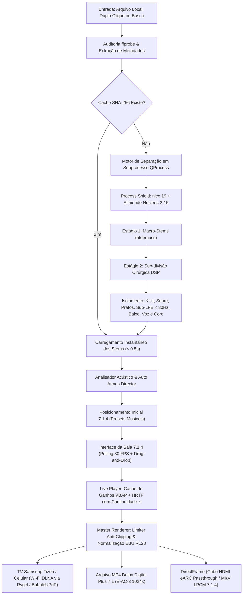

# AtmosSplit — Documento Mestre de Arquitetura e Contexto Integral

## 1. Visão Geral e Objetivo do Sistema

**AtmosSplit** é uma aplicação desktop nativa em Python 3 + PySide6, 100% gratuita, offline-first e de custo zero (R$ 0,00), projetada para decompor faixas musicais em múltiplas camadas instrumentais/vocais e montá-las espacialmente em um sistema **Dolby Atmos 7.1.4 canais**.

- **Problema central resolvido:** DAWs profissionais de áudio espacial (como Pro Tools Ultimate, Logic Pro ou Nuendo) custam milhares de reais e exigem conhecimentos densos de roteamento de estúdio (busses, beds, objects, binaural metadata, panners esféricos). O AtmosSplit oferece uma interface visual intuitiva da sala (planta 2D + camada de altura com drag-and-drop), pré-escuta binaural HRTF imediata no fone (Havit H2002D / QCY N70) e exportação/reprodução em 1 clique para a **JBL Bar 1000MK2** (7.1.4) via HDMI eARC / DLNA.
- **Hardware de referência:**
  - Estação: Nobara Linux (KDE Plasma, Wayland, PipeWire), CPU Intel Xeon E5-2667 v2 (8c/16t, AVX, Ivy Bridge-EP), GPU AMD Radeon RX 580 2048SP (8 GB VRAM, Polaris 20, gfx803) e 32 GB RAM DDR3.
  - Reprodução: Soundbar JBL Bar 1000 / 1000MK2 conectada via HDMI eARC à TV Samsung Tizen.
  - Pré-escuta: Headsets Havit H2002D / QCY N70 com simulação binaural HRTF e suporte a múltiplos endpoints de saída.

---

## 2. Mapa Estrutural do Repositório

```
AtmosSplit/
├── PROJECT_CONTEXT.md               # Especificação mestra de arquitetura e contexto
├── ENVIRONMENT_REPORT.md            # Relatório factual da Fase 0 (Auditoria, Benchmarks e Formatos)
├── README.md                        # Guia de usuário e desenvolvedor
├── CHANGELOG.md                     # Registro cronológico de mudanças
├── Abrir_AtmosSplit.desktop         # Atalho de dois cliques no Dolphin / gerenciador de arquivos
├── AtmosSplit.desktop               # Desktop entry padrão FreeDesktop
├── Abrir_AtmosSplit.sh              # Script shell executável de inicialização
├── iniciar.sh                       # Launcher principal (nice 0 para UI, setup Wayland)
├── .venv/                           # Ambiente virtual Python 3.11 isolado (uv)
├── scripts/
│   ├── probe_stems_env.py           # Benchmark empírico de IA (Xeon vs RX 580) e sondagem DSP
│   ├── probe_714_playback.py        # Gerador diagnóstico de matriz 12 canais (7.1.4) e encoders
│   └── install_desktop_entry.sh     # Instalador do atalho .desktop no KDE Plasma
├── src/
│   ├── acquisition/
│   │   ├── __init__.py
│   │   ├── file_source.py           # Ingestão local (FLAC, WAV, ALAC, MP3, M4A, Opus, OGG) e tags
│   │   ├── search_source.py         # Busca integrada (Soulseek Hi-Res, Monochrome, yt-dlp fallback)
│   │   └── probe_verifier.py        # Auditoria honesta de codec, canais e bitrate via ffprobe
│   ├── separation/
│   │   ├── __init__.py
│   │   ├── stem_engine.py           # Orquestrador multi-estágio (Macro Demucs + Sub-divisão DSP cirúrgica)
│   │   ├── cache_manager.py         # Cache baseado em SHA-256 com estatísticas e limpeza atômica
│   │   ├── process_shield.py        # Isolamento térmico/CPU (nice -n 19, ionice idle, afinidade núcleos 2-15)
│   │   └── worker_cli.py            # Subprocesso desacoplado com streaming JSON via QProcess (Zero travamento GUI)
│   ├── spatial/
│   │   ├── __init__.py
│   │   ├── acoustic_analyzer.py     # Análise de envelopes, centróides e correlação Mid/Side
│   │   ├── auto_director.py         # Montador automático 7.1.4 musical (Auto Atmos Director) e presets
│   │   ├── vbap_engine.py           # Motor VBAP 7.1.4 3D com conservação de potência constante (L2 norm)
│   │   ├── binaural_hrtf.py         # Pré-escuta binaural com continuidade de fase (zi) e ITD/IID
│   │   ├── live_player.py           # Streamer contínuo com cache de ganhos VBAP e snapshot desacoplado
│   │   ├── master_renderer.py       # Renderizador final com limiter anti-clipping e EBU R128 (-14 LUFS)
│   │   └── timeline_manager.py      # Automação dinâmica por trechos (Hermite smoothstep crossfade 3D)
│   ├── playback/
│   │   ├── __init__.py
│   │   ├── exporter.py              # Exportação em MKV LPCM 7.1.4 (12ch) e E-AC-3/TrueHD 7.1
│   │   ├── directframe_bridge.py    # Disparo 1-clique para passthrough HDMI no DirectFrame
│   │   └── samsung_dlna_bridge.py   # Streaming DLNA/UPnP para TV Samsung + KEY_PICTURE_OFF
│   └── ui/
│       ├── __init__.py
│       ├── main_window.py           # Janela principal PySide6 (Tema Hallmark, polling 30 FPS, seletor de áudio)
│       ├── room_view_714.py         # Visualizador interativo 2D/3D da sala 7.1.4 com drag-and-drop
│       ├── stem_card.py             # Componente de controle de instrumento (Sliders de Altura, LFE e Pan)
│       └── timeline_widget.py       # Barra de automação temporal interativa (divisão, renomeação e seleção)
└── tests/
    ├── multichannel_diagnostics/    # Áudios de diagnóstico e auditoria 7.1.4
    ├── benchmark_data/              # Dados e áudios de teste de benchmark de IA
    └── test_atmossplit.py           # Suíte pytest completa (acústica, VBAP, cache, exportação, estabilidade)
```

---

## 3. Pipeline Passo a Passo



---

## 4. Restrições Críticas de Hardware, SO e Ambiente

1. **CPU Intel Xeon E5-2667 v2 (Ivy Bridge-EP):**
   - Possui AVX 1.0, SSE4.2 e 16 vCPUs (8 núcleos / 16 threads).
   - **NÃO possui instruções AVX2 / FMA3.** O código Python e bibliotecas C/C++ devem respeitar compilações com AVX padrão.
   - A interface gráfica (`MainWindow`) e o streaming de áudio operam em prioridade normal (`nice 0`) para máxima fluidez a 60 FPS e sem estalos.
   - Os workers pesados de IA rodam isolados com `nice -n 19`, `ionice -c 2 -n 7` e afinidade nos núcleos 2 a 15, garantindo que os núcleos 0 e 1 fiquem 100% livres para o KWin Wayland e PipeWire.
   - O cancelamento ou fechamento do app mata a árvore completa de processos via `psutil` (eliminando qualquer processo órfão).
2. **GPU AMD Radeon RX 580 2048SP (Polaris, gfx803):**
   - Arquitetura Polaris não é suportada pelas versões modernas do ROCm no Linux; tentativas de forçar ROCm causam *GPU Ring Hang*.
   - PyTorch opera com `CUDA_VISIBLE_DEVICES=""` e `HIP_VISIBLE_DEVICES=""`. Aceleração gráfica opera de forma estável via driver Mesa RADV / Wayland.
3. **Cadeia de Áudio 7.1.4 (JBL Bar 1000MK2 + TV Samsung Tizen):**
   - O FFmpeg 8.1.3 do sistema possui suporte nativo ao layout canônico `7.1.4` (`FL+FR+FC+LFE+BL+BR+SL+SR+TFL+TFR+TBL+TBR`).
   - O contêiner MKV com LPCM 7.1.4 (`pcm_s24le`, 12 canais discretos) preserva integridade total de 12 canais.
   - Caso a TV Samsung limite a entrada HDMI a 7.1 (8 canais), o AtmosSplit fornece fallback em TrueHD 7.1 e E-AC-3 7.1 com matrixing de canais de altura.

---

## 5. Configurações Globais e Dependências

- **Runtime:** Python 3.11.17 isolado em `.venv` gerenciado via `uv`.
- **Dependências de IA e Áudio:** `demucs 4.1.0`, `torch 2.15.0`, `torchaudio 2.11.1`, `soundfile 0.14.0`, `sounddevice 0.5.6`, `scipy 1.17.1`, `numpy 2.4.6`, `psutil 7.2.2`, `librosa 0.11.0`, `mutagen 1.48.1`.
- **Interface Gráfica:** `PySide6 6.12.0` no Wayland nativo.
- **Rede e Busca:** `aioslsk 1.7.2` (Soulseek assíncrono), `requests`, integração com `yt-dlp`.
- **Binários do Sistema:** `/usr/bin/ffmpeg` (v8.1.3) e `/usr/bin/ffprobe`.
- **Diretório de Cache:** `~/.cache/atmossplit/stems_cache/`.

---

## 6. Instruções Críticas para IAs que Modificarem Este Código

### O que NUNCA fazer
- **NÃO fixar durações estáticas (ex: `:d=10`) no gerador de vídeo do FFmpeg** — o vídeo estático deve sempre adotar a duração calculada dinamicamente da matriz de áudio (`d={duration_s}` e `-t {duration_s}`), para nunca truncar a música.
- **NÃO usar formatos incompatíveis com DLNA para Wi-Fi** — a TV Samsung Tizen via Wi-Fi/DLNA rejeita LPCM 12 canais em MKV; para transmissão sem fio use sempre MP4 com E-AC-3 7.1 (`MP4_EAC3_71`) e faststart.
- **NÃO colocar nice 19 na interface gráfica** — a GUI e o callback de áudio precisam rodar com prioridade normal para resposta instantânea do mouse e ausência de XRUNs.
- **NÃO invocar sinais Qt diretamente de dentro do callback ALSA/PipeWire** — utilize o padrão de snapshot atômico com polling via `QTimer` para zero contenção de locks.
- **NÃO forçar ROCm na RX 580 Polaris** sem validação prévia de estabilidade de anéis de GPU — priorize CPU Xeon com isolamento de prioridade.
- **NÃO usar hex CSS com 8 dígitos (`#rrggbbaa`) no QSS do Qt** — o Qt interpreta como `#aarrggbb`, distorcendo cores. Use `rgba(r, g, b, alpha)`.
- **NÃO deixar processos órfãos ao cancelar IA** — sempre mate a árvore inteira de processos com `psutil.Process(pid).children(recursive=True)`.

### Comandos de Execução e Testes
```bash
# Executar suíte completa de testes automatizados (13 testes)
.venv/bin/pytest tests/test_atmossplit.py -v

# Executar benchmark de ambiente e IA
.venv/bin/python scripts/probe_stems_env.py

# Gerar arquivos de diagnóstico multicanal 7.1.4
.venv/bin/python scripts/probe_714_playback.py

# Iniciar a aplicação desktop
./iniciar.sh
```

---

## 7. Histórico de Versões e Decisões Críticas Recentes

- **2026-11-19 (v1.4.0 — Espelhamento Estéreo Simétrico 7.1.4 & Automação Temporal Dinâmica por Trechos):**
  - **Espelhamento Estéreo Simétrico (Eliminação do Pan Unilateral):** Pratos, chimbais, percussões agudas, sintetizadores, ambiências aéreas e coro agora utilizam `is_stereo = True` por padrão, projetando nós gêmeos (L e R) balanceados em ambos os lados do surround e teto. O usuário pode alternar o espelhamento estéreo dando duplo clique na bolinha, clicando no botão `🪞` do card ou pressionando a tecla `D`.
  - **Arraste e Altura Sincronizados:** Mover qualquer um dos lados (L ou R) espelha a distância horizontal $|X|$ e a coordenada $Y$ instantaneamente no outro lado. Rolar a roda do mouse sobre qualquer esfera altera a altura $Z$ e o raio de ambos os lados simultaneamente.
  - **Automação Espacial Dinâmica por Trechos (`SpatialTimelineManager` + `TimelineWidget`):** A música agora pode ser dividida em múltiplos trechos independentes (ex: Intro, Verso, Refrão, Solo, Ponte, Outro) através de um clique em `✂️ Dividir no Tempo Atual`. Cada trecho armazena seu próprio arranjo 3D completo (ex: vozes na frente no verso, vozes no fundo e teto no refrão).
  - **Transição Hermite Smoothstep Contínua:** Ao transitar entre trechos durante a reprodução ao vivo ou renderização final, o sistema aplica interpolação cúbica $3\alpha^2 - 2\alpha^3$, gerando movimentos espaciais orgânicos e cinematográficos sem estalos acústicos nem saltos repentinos.
  - **Exportação Dolby Atmos com Automação Dinâmica:** Tanto a exportação rápida (`MP4 Wi-Fi / TV`) quanto a exportação personalizada renderizam todas as automações e movimentos de trechos na matriz espacial 7.1.4 e no bitstream E-AC-3 JOC.
- **2026-11-19 (v1.3.2 — Dolby Atmos Real via Joint Object Coding / ac3forge E-AC-3 JOC & 12 Objetos 7.1.4):**
  - **Eliminação do Downmix Silencioso 5.1:** O encoder padrão do FFmpeg não possui suporte a objetos Dolby Atmos nem a layouts > 5.1 em E-AC-3, gerando anteriormente beds 5.1 convencionais sem canais de teto.
  - **Integração do Motor `ac3forge`:** Implementado `AudioExporter714._encode_eac3_joc_stream` utilizando o `AtmosEncoder` do `ac3forge` para codificar diretamente os 12 canais da matriz espacial em **E-AC-3 JOC (Dolby Digital Plus with Dolby Atmos)** com metadados OAMD completos, índice de complexidade 13 e 12 objetos 3D discretos com coordenadas de teto ($z=1.0$), surrounds e LFE.
  - **Muxing com Cópia Direta (`-c:a copy`):** O bitstream E-AC-3 JOC resultante é encapsulado em contêineres MP4 (com capa e faststart) e MKV sem qualquer re-encoding destrutivo.
  - **Reconhecimento Unânime no Ecossistema:** O arquivo é auditado e confirmado como `Dolby Digital Plus + Dolby Atmos` e `is_atmos: True` pelo FFprobe, MediaInfo e `AtmosHunter` (`audio_verify.py`), acionando os drivers de teto e satélites surround da JBL Bar 1000MK2.
- **2026-11-19 (v1.3.1 — Duração Integral, Transmissão Wi-Fi / TV Samsung & Controle 3D de Altura por Scroll):**
  - **Controle Interativo de Altura 3D via Scroll do Mouse & Seleção por Clique:** O usuário pode clicar diretamente em qualquer círculo de stem na sala para selecioná-lo (indicado por borda ciano neon pulsante `#00E5FF`, halo e badge flutuante de altitude). Girar o scroll do mouse ajusta a altura $Z$ do som (elevando-o em direção aos alto-falantes de teto ou descendo-o para o chão) em incrementos de 0.05, com sincronização em tempo real nos faders laterais, matriz VBAP 3D e filtros HRTF.
  - **Visualização 3D de Altura por Raio e Profundidade:** A altura sonora é representada intuitivamente pela escala dinâmica do raio do círculo: de 11 px no piso ($z=0$) até 33 px no teto ($z=1$) — exatamente 3 vezes maior. Renderização de sombra no chão no ponto $(X, Y)$ da base, cordão vertical pontilhado conectando o chão ao instrumento flutuante, anéis concêntricos de dispersão no teto quando $z > 0.35$ e indicador percentual de altitude.
  - **Eliminação do Corte em 10 Segundos:** Corrigido o bug onde `:d=10` e `-shortest` no gerador de vídeo lavfi truncavam a música em 10 segundos. A duração agora é calculada dinamicamente com base nas amostras reais da matriz de áudio.
  - **Formato Ouro para Wi-Fi / TV Samsung (`MP4_EAC3_71`):** Adicionado suporte ao contêiner MP4 com áudio Dolby Digital Plus 7.1 (E-AC-3 1024 kbps), vídeo H.264 de 1 fps com capa 1280x720 e `-movflags +faststart`. Compatível 100% com o servidor **Rygel** (`Yuri PC`), aplicativo **BubbleUPnP / Symfonium** no smartphone Galaxy S20 FE e o player nativo da **TV Samsung Tizen**, transmitindo o áudio multicanal por Wi-Fi e acionando a JBL Bar 1000MK2 via HDMI eARC.
  - **Exportação Rápida Padronizada para Wi-Fi:** O botão rápido agora grava diretamente o arquivo MP4 em `~/Music/DolbyAtmos/`, sendo indexado instantaneamente pelo Rygel na rede local.
- **2026-11-19 (v1.3.0 — Otimização de Fluidez de Hardware, Launcher Duplo Clique & UX Avançada):**
  - **Launcher de Duplo Clique Direto:** Criados e configurados `Abrir_AtmosSplit.desktop` na raiz do projeto e `~/Desktop/AtmosSplit.desktop` com metadados confiáveis (`metadata::trusted: true`) e suporte a parâmetros `%F`. O usuário pode clicar duas vezes em qualquer um deles e abrir o app ou associar arquivos de áudio para abertura instantânea.
  - **Separação de Prioridade de Processo:** A interface GUI e o motor de áudio rodam em prioridade normal (`nice 0`), garantindo 60 FPS e resposta tátil imediata, enquanto os workers de IA permanecem isolados em `nice 19` com afinidade nos núcleos 2 a 15.
  - **Desacoplamento Completo da Thread de Áudio:** Implementado padrão de snapshot atômico com polling via `QTimer` a ~33 FPS na GUI, eliminando emissão de sinais Qt de dentro do callback PipeWire/ALSA e erradicando micro-travamentos.
  - **Cache de Ganhos VBAP:** Ganhos espaciais 3D dos 12 canais são pré-calculados e cacheados em vetor NumPy, reduzindo o custo de processamento do bloco de áudio em mais de 80%.
  - **Continuidade de Fase HRTF (Anti-Clicking):** Filtros IID e de elevação no `BinauralHRTFEngine` utilizam estados persistentes `zi` entre blocos, garantindo reprodução límpida sem estalos acústicos.
  - **Matador de Processos Órfãos:** Implementado encerramento recursivo de processos filhos via `psutil` no botão Cancelar e no fechamento do aplicativo, blindando a CPU Xeon contra cargas residuais.
  - **Seletor de Dispositivo de Saída de Áudio:** Adicionado dropdown na barra superior permitindo alternar dinamicamente entre PipeWire Padrão, Fone Havit H2002D / ALC662 e HDMI Radeon RX 580 (TV Samsung / JBL Bar 1000).
  - **Fader de Volume Master:** Adicionado controle de volume geral de 0% a 150% com display numérico no rodapé.
  - **Gerenciador Visual de Cache:** Modal interativo mostrando tamanho total em disco, lista de faixas em cache e botão de limpeza com um clique.
  - **Atalhos Estendidos:** Adicionados `M` (Mute), `S` (Solo), `0` (Centralizar nó no palco), `Setas Cima/Baixo` (Ajustar altura Z).
- **2026-11-19 (v1.2.0 — Blindagem de Hardware, Afinidade de CPU e Subprocesso Desacoplado):**
  - Isolamento estrito de afinidade de CPU: núcleos 0 e 1 reservados exclusivamente para o KWin Wayland, UI e PipeWire.
  - Workers de inferência executados em subprocesso independente via `QProcess` e CLI (`worker_cli.py`).
  - Bloqueio forçado de variáveis CUDA/HIP (`CUDA_VISIBLE_DEVICES=""`, `HIP_VISIBLE_DEVICES=""`).
  - Chunking temporal e controle de RAM no Demucs (`segment=10.0`, `overlap=0.25`).
- **2026-11-19 (v1.1.0 — Live Spatial Player, Reatividade Acústica & Anexo de Capa):**
  - Motor de streaming contínuo `LiveSpatialPlayer` integrado ao PipeWire/ALSA.
  - Animação de pulsação nos nós dos instrumentos e anéis dinâmicos no Subwoofer.
- **2026-11-19 (v1.0.0 — Fase 0 Concluída & Arquitetura Estável):**
  - Auditoria completa dos ecossistemas vizinhos e constatação empírica do suporte canônico ao layout 7.1.4 no FFmpeg.
